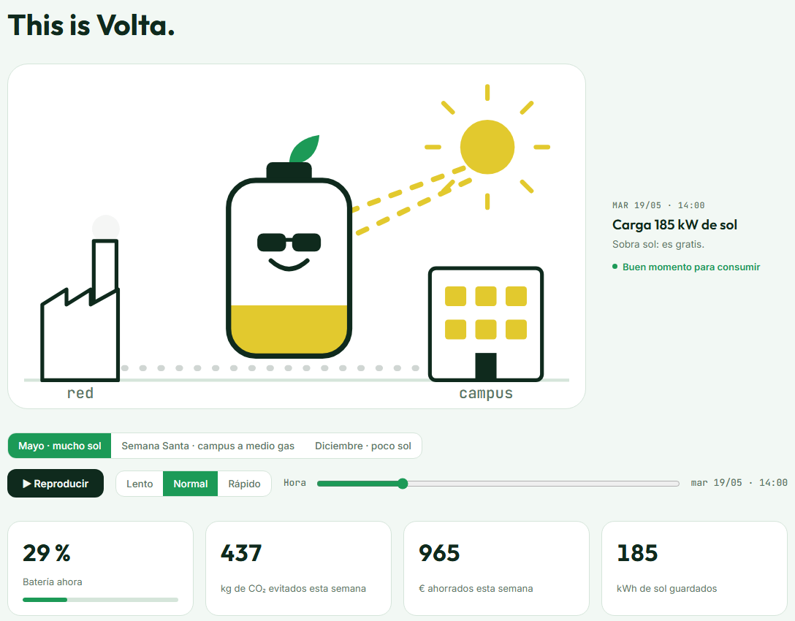

# Volta · la batería del Campus Nord, operada en el óptimo

Repte UPC Sostenible · Datathon 2026 · equipo **hackers la l** (Alexander Hall Parrilla, Oscar Senesi Aladjem)

Un agente que decide cada hora cuánto cargar o descargar la batería del campus para reducir el CO₂
(70 % del Score) y la factura (30 %), y **Volta**, una página que explica cada decisión y dice al
campus qué conviene hacer en ese momento.



## El motor en una idea

El Score del reto es **lineal** en la energía que el campus importa de la red. Con el caso base fijo,
reducir CO₂ y coste equivale a **minimizar, hora a hora, `importación × w`**, con una única señal
`w = CO₂ + λ·precio` (λ sale de la propia fórmula 70/30). Así que el problema es un **programa lineal**:

1. **Leer** el precio y el CO₂ conocidos y el nivel de la batería.
2. **Optimizar** con HiGHS el plan exacto de carga y descarga de las próximas horas (rendimiento, capacidad
   y potencia incluidos).
3. **Actuar** solo en la primera hora, con un recorte de seguridad (0 infracciones), y repetir cada hora.

En el modo estándar basta eso: la solar es el 2,4 % de la demanda y la demanda neta supera los 500 kW de la
batería el 99,5 % de las horas, así que no hay nada que predecir. En el modo difícil se mantiene el mismo
optimizador, pero alimentado con previsiones (precio y CO₂, demanda y solar) y con una descarga prudente,
porque lo que el campus no consume se pierde.

## Resultados

- Con la batería actual: unas **42 t de CO₂ y 91.000 € al año** evitados (anualizado desde el año de entrenamiento).
- Modo estándar: el agente evita el **99,85 %** del beneficio de un plan que conoce el año entero (5,6667 frente a
  5,6753 de Score en entrenamiento) y 0 infracciones.
- Modo difícil: el agente local llega al **93 %** de ese plan perfecto con solo 3 h de mercado; con la solar de
  la hora o el precio de mañana conocidos, llegaría al 96 %. Detalle en `analysis/hard_findings.md`.

## La idea

1. **Mirar los datos antes de modelar.** La solar es el 2,4 % de la demanda y la demanda neta supera
   los 500 kW de la batería el 99,5 % de las horas: en el modo estándar la batería nunca vierte a red y
   prever la demanda no aporta. Es arbitraje puro.
2. **El Score es lineal** en la energía importada de la red, así que se reduce a una sola señal por hora:
   `w = CO₂ + λ·precio`, con `λ = (0,3/0,7)·CO₂_base/Coste_base`. La fórmula oficial valora la tonelada
   de CO₂ en unos 3.900 €.
3. **Programa lineal exacto** sobre las horas conocidas, resuelto cada hora (control predictivo), con un
   recorte de seguridad que garantiza 0 infracciones. Lo comparamos con un programa lineal que conoce el
   año entero: estamos a 0,0009 puntos de la cota en semanas tipo test.

**Modo difícil.** Mismo optimizador con tres previsiones y prudencia ante la incertidumbre:
- precio y CO₂ de 3 a 23 h: una regresión por hora de adelanto sobre cocientes a un perfil mes × tipo de día × hora;
- demanda: última medida × perfil semanal, con el **calendario de festivos y periodos no lectivos de la UPC**
  (público y conocido de antemano; +0,155 fuera de muestra en semanas con festivos);
- solar de la hora en curso: 150 árboles (LightGBM) exportados y evaluados en Python puro dentro de `agent.py`;
- descarga de la hora en curso hasta un cuantil de la demanda neta que depende del valor de la energía
  guardada (dual del programa lineal).

Medimos dónde queda la pérdida dando al agente información perfecta por partes: con precio y CO₂ reales a
24 h llegaría al 96 % de la cota; con la demanda neta real de la hora en curso, también al 96 %.

**Datos.** Solo los datos oficiales del reto y el calendario público. No usamos el tiempo, los precios ni
la demanda reales de las semanas de test.

## Volta

Página interactiva (HTML + SVG, sin dependencias) con tres semanas de ejemplo simuladas con el agente del
modo difícil: Volta se pone gafas de sol cuando carga con sol, frunce el ceño cuando descarga en horas de
más CO₂ y duerme cuando espera, y va contando el CO₂ evitado, los euros y el sol guardado.

- Abrir `ui/bot_local.html` en cualquier navegador (ver la captura de arriba).
- Regenerar: `./.venv/Scripts/python.exe -m ui.build_bot`

## Estructura

```text
agent/agent.py            agente del modo estándar (fuente de las entregas v1-v3)
agent_hard/agent.py       agente del modo difícil (los perfiles se inyectan con tools/hard_pack.py)
submissions/<tag>/        exactamente lo que se subió a la web; LOG.md con cada resultado
tools/                    build_hourly.py, evaluate.py (banco de pruebas y cota), hard.py (simulador
                          del modo difícil, perfiles, modelos), hard_pack.py (congela una entrega)
analysis/                 estudios reproducibles y sus conclusiones (*_findings.md)
figures/                  figuras de la presentación
slides/                   presentacion.pptx (build_deck.py), guion.md (qué decir), qa.md (preguntas)
ui/                       Volta
starter_kit/, docs/       material oficial del reto (docs/README_kit.md es su README original)
```

## Reproducir

```bash
python -m venv .venv
./.venv/Scripts/python.exe -m pip install -r requirements.txt
# descargar el paquete oficial de participantes y descomprimir data/train/ en la raíz (no se incluye)
./.venv/Scripts/python.exe tools/build_hourly.py
./.venv/Scripts/python.exe tools/evaluate.py          # modo estándar: score, cota, infracciones
./.venv/Scripts/python.exe -m tools.hard build
./.venv/Scripts/python.exe -m tools.hard              # modo difícil
./.venv/Scripts/python.exe -m tools.hard_pack hard_v6 # entrega de un solo fichero
./.venv/Scripts/python.exe starter_kit/check_submission.py submissions/hard_v6/agent.py
```

Las conclusiones con todos los números están en `analysis/eda_findings.md`, `strategy_findings.md`,
`outage_findings.md`, `whatif_findings.md`, `split_noise_findings.md`, `lowload_findings.md` y
`hard_findings.md`.
